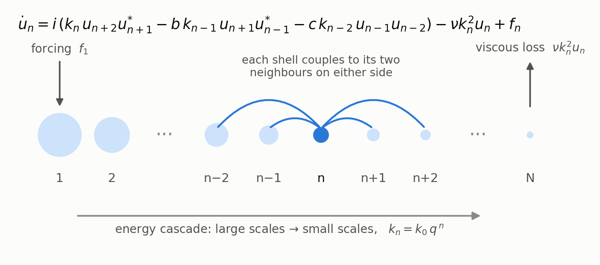
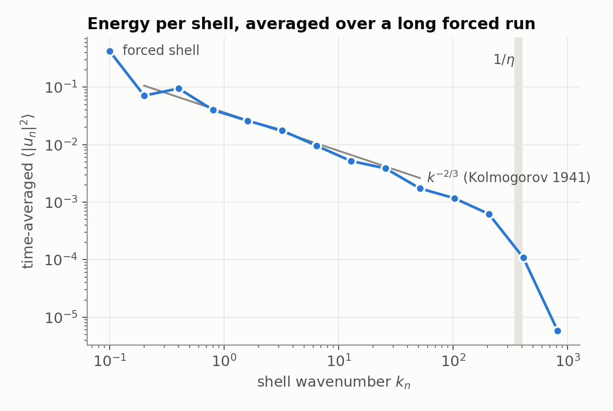
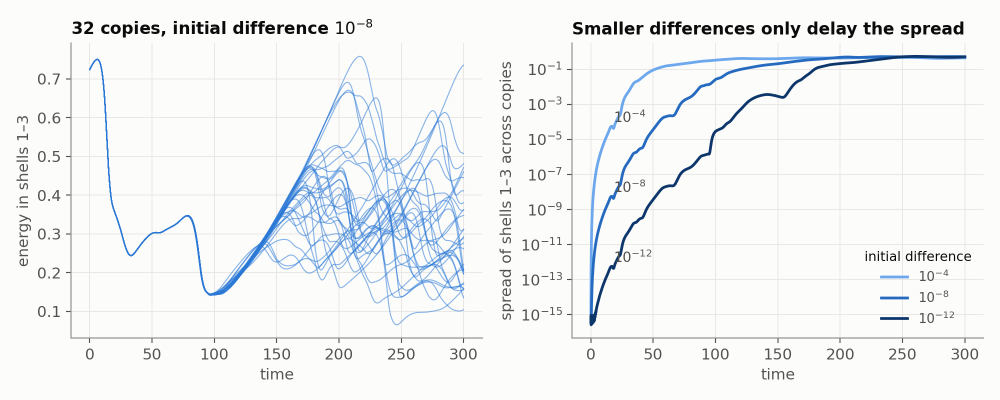

## The Sabra shell model

Turbulence carries energy from large eddies to ever smaller ones until viscosity
dissipates it into thermal energy. A shell model keeps this cascade but replaces the
three-dimensional velocity field with a chain of complex amplitudes $u_n$. Each
amplitude stands for one octave of wavenumbers, $k_n = k_0 q^n$ with $q = 2$.
Each shell exchanges energy only with its nearest neighbours, through quadratic
terms that conserve energy, as the Navier–Stokes nonlinearity does.



$$
\frac{du_n}{dt} = i\left(k_n u_{n+2} u_{n+1}^* - b\,k_{n-1} u_{n+1} u_{n-1}^* - c\,k_{n-2} u_{n-1} u_{n-2}\right) - \nu k_n^2 u_n + f_n ,
$$

- **Energy conservation** requires $c = b - 1$; we use $b = 1/2$.
- **Boundaries:** shells outside $1,\dots,N$ are zero.
- **Forcing** acts on the first shell.

The convention follows Li et al. (2025); the model is due to L'vov et al. (1998).

### What it is used for

With a few dozen complex variables instead of millions, shell models reproduce
central statistical features of turbulence:

- Kolmogorov scaling $\langle|u_n|^2\rangle \propto k_n^{-2/3}$;
- intermittency;
- chaos at every scale.

They do so at a cost that allows very long runs and large ensembles, and are used as testbeds to study predictability and synchronization, and
*spontaneous stochasticity*: whether randomness can persist in turbulent flow as
viscosity and the uncertainty in its initial conditions both go to zero.

<p align="center"></p>

*Time-averaged energy per shell from a $10^9$-step run (14 shells,
$\nu = 6.104\times10^{-5}$). Between the forced shell and the viscous range near
$1/\eta$, the spectrum roughly follows $k^{-2/3}$.*



*32 copies of one state that differ only in the smallest scales (shells 10–14).*

- *Left: the large-scale energy of each copy.*
- *Right: how far the copies' large scales spread apart. A $10^4$-fold smaller
  initial difference delays the spread but does not prevent it.*
- *This is a single viscosity. Whether that delay stays bounded as $\nu \to 0$
  is the open question.*

## Contents

| Directory | What it holds |
|---|---|
| [`solver/`](solver/) | Header-only C++17 core, C API, tests and benchmark |
| [`lean/`](lean/) | Lean 4 / mathlib proofs; each file is described in [`lean/README.md`](lean/README.md) |
| [`docs/images/`](docs/images/) | Figures |

## Solver

The solver integrates the model with classical fourth-order Runge–Kutta (RK4),
evaluating the full right-hand side at every stage.

- **Diagnostics:** it records energy, dissipation, power input and per-shell
  energy.
- **Ensembles:** it runs ensembles of perturbed copies across threads, with
  results independent of the thread count.
- **Arithmetic:** it uses plain IEEE-754 operations, without fast-math or fused
  multiply-add, so repeated runs agree bit for bit.
- **Speed:** one RK4 step takes about 0.21 µs with 14 shells and 0.32 µs with 22
  shells, on one Apple M1 core.

```sh
cmake -S solver -B build -DCMAKE_BUILD_TYPE=Release
cmake --build build
./build/sabra_tests    # native checks
./build/sabra_bench    # throughput
```

[`bench/bench_sabra.cpp`](solver/bench/bench_sabra.cpp) is a complete usage
example.

## Lean proofs

The proofs are machine-checked statements in exact real arithmetic. They cover:

- **The solver's formula:** the expression the solver evaluates, including its
  zero boundary shells, equals the triad form of the model.
- **Energy conservation:** the nonlinear terms conserve energy.
- **The RK4 step:** the energy change of one step has an exact formula, and an
  explicit three-shell example shows that the step does not conserve energy
  exactly.

The proofs do not verify floating-point execution. To build them, run
`cd lean && lake exe cache get && lake build`.

## References

- V. S. L'vov, E. Podivilov, A. Pomyalov, I. Procaccia and D. Vandembroucq,
  "Improved shell model of turbulence," *Phys. Rev. E* **58**, 1811 (1998).
- J. Li, W. Si, Y. Li and P. Xu, "Intrinsic relationship between
  synchronisation thresholds and Lyapunov vectors: evidence from large eddy
  simulations and shell models," *J. Fluid Mech.* **1008**, A27 (2025).
- L. Biferale, "Shell models of energy cascade in turbulence," *Annu. Rev. Fluid
  Mech.* **35**, 441 (2003).
- E. N. Lorenz, "The predictability of a flow which possesses many scales of
  motion," *Tellus* **21**, 289 (1969).
- A. A. Mailybaev, "Spontaneous stochasticity of velocity in turbulence models,"
  *Multiscale Model. Simul.* **14**, 96 (2016).